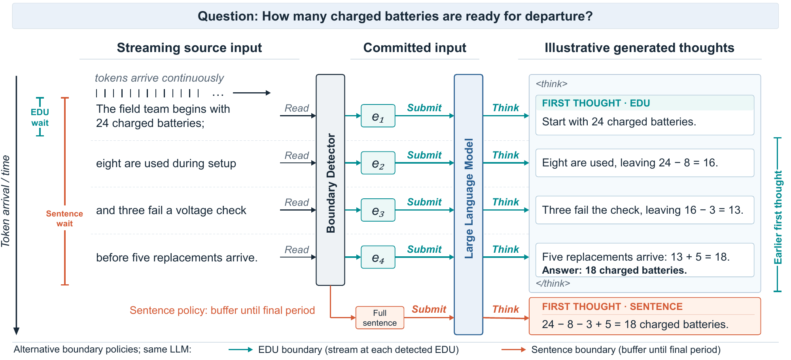
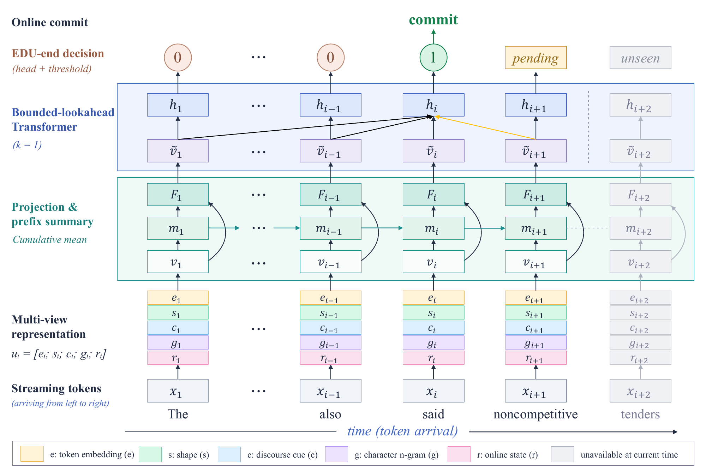
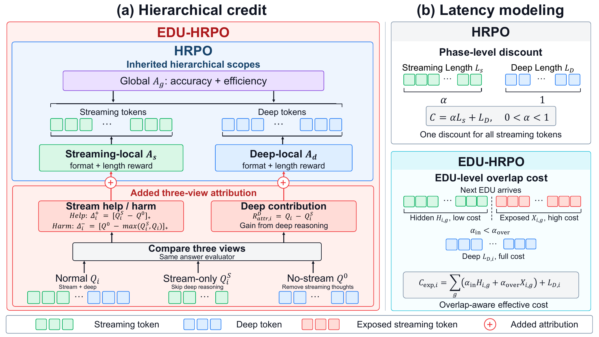

# EDUSR

### Think Earlier with Elementary Discourse Unit-Level Streaming Reasoning

**Anonymous code release**

EDUSR organizes streaming reasoning around Elementary Discourse Units (EDUs), which express relatively complete local meaning. An online segmenter commits EDUs before sentence completion; EDU-aligned supervised fine-tuning (SFT) adapts local reasoning to this granularity; EDU-aware Hierarchical Relative Policy Optimization (EDU-HRPO) then refines the SFT policy.



*An illustrative example: committed EDUs enable local reasoning before the full sentence arrives. The displayed thoughts illustrate the mechanism and are not benchmark results.* [PDF](assets/figures/edu-streaming-example.pdf)

## Method

1. **Online EDU segmentation.** End-boundary prediction combines observed-text features, cumulative prefix history, and bounded lookahead. The paper uses `k=1` and a validation-selected threshold of `0.38` to balance boundary accuracy, commitment delay, and short-deadline segmentation quality.
2. **EDU-level reasoning and Arrival-Triggered Preemption (ATP).** SFT aligns local thoughts with EDU inputs while retaining StreamingThinker's prefix-constrained attention and separate position encoding. ATP pauses decoding after the current token, incrementally prefills new input, updates the source cache, and resumes using the latest visible prefix. Previously generated reasoning tokens and their caches are preserved.
3. **EDU-HRPO.** Counterfactual answer views attribute reasoning quality to the streaming and deep stages. Arrival-aware costs distinguish computation covered by input waiting from exposed computation. Streaming-local, deep-local, and trajectory-global objectives are clipped separately and then combined using HRPO.

### Online boundary detection



*Prefix aggregation and bounded lookahead support incremental EDU-end decisions.* [PDF](assets/figures/online-edu-segmentation.pdf)

### Hierarchical optimization



*Three answer views support stage attribution; EDU arrival times determine computation overlapped with input waiting and exposed computation. The diagram summarizes the method; exact reward definitions are implemented in the modules below.* [PDF](assets/figures/edu-hrpo.pdf)

## Repository layout

| Component | Location |
|---|---|
| Online segmentation and feature extraction | `Streaming_EDU/src/final_edu/` |
| Segmenter training and auxiliary objectives | `EDU_codex/src/stream_edu/` |
| EDU-aligned SFT and streaming attention | `StreamingThinker/dataloader_hf.py`, `streaming_trainer.py`, `Qwen3/` |
| Incremental input and preemptive generation | `StreamingThinker/online_edu_segmenter.py`, `generation/` |
| Counterfactual attribution and arrival-aware costs | `ST_RL/EDU_HRPO/` |
| HRPO policy clipping and distributed training infrastructure | `ST_RL/HRPO/` |
| Task prompts | `StreamingThinker/configs/rl_eval/`, `ST_RL/prompt_configs/` |
| Unified command-line entry | `run.py` |

See [Method-to-code mapping](METHOD_MAP.md), [Data formats](DATA_FORMATS.md), and [Validation](VALIDATION.md).

## Installation

Use **Python 3.11**. Full SFT and distributed RL are intended for Linux with NVIDIA GPUs. Install an appropriate PyTorch build for your system, then install the dependencies for your workflow:

```bash
python -m pip install -r requirements-inference.txt
python run.py --help
```

For distributed RL, use `requirements-rl.txt` in a dedicated environment. It specifies the vLLM version used by the training implementation. DeepSpeed is optional; the SFT example below disables it.

Model weights, training datasets, teacher trajectories, and evaluation outputs are **not included**. Prepare these assets separately. Core logic and entry-point loading have been tested; this release has not rerun full GPU training or reproduced the paper's benchmark results.

## Quick start

Run commands from the repository root. Paths under `checkpoints/`, `data/`, and `outputs/` are examples for assets you provide or generate.

### 1. Segment an incoming text stream

```bash
python run.py segment --checkpoint checkpoints/segmenter.pt --device cpu --threshold 0.38 --stream --text "The battery has ten units, and charging adds three."
```

The segmenter checkpoint must contain the vocabulary, configuration, and weights saved by its training pipeline. Load only trusted checkpoints.

To train the segmenter with the main architectural and auxiliary-loss settings:

```bash
python run.py train-segmenter --name edusr_k1 --data-root data/segmentation --out-dir outputs/segmenter --lookahead 1 --prefix-summary --use-stream-feats --stream-dim 16 --use-cue --cue-dim 16 --char-dim 64 --char-slots 18 --char-buckets 4096 --aux-start-weight 0.22 --aux-dist-weight 0.18 --count-loss-weight 0.32 --rule-distill-weight 0.02
```

The data loader expects `train/gum_train.online.jsonl` and `dev/gum_dev.online.jsonl` beneath the data root. See [Data formats](DATA_FORMATS.md). Architecture defaults alone do not identify the paper's final checkpoint.

### 2. Prepare EDU inputs and perform SFT

```bash
python run.py prepare-inputs --input data/source.json --output outputs/edu_inputs.json --checkpoint checkpoints/segmenter.pt --device cpu
python run.py sft --model_name_or_path checkpoints/qwen3 --data_config configs/sft.json --output_dir outputs/sft --learning_rate 1e-5 --num_train_epochs 3 --lr_scheduler_type linear --seed 1 --per_device_train_batch_size 1 --gradient_accumulation_steps 16 --no-use_lora --deepspeed none --report_to none
```

`prepare-inputs` segments inputs; it does not generate teacher reasoning. SFT requires local reasoning targets aligned with the question/context units. The example configuration targets short-answer QA and reads `data/sft_train.json`; adapt the task prompt and data path for other tasks.

The SFT example uses full-parameter bfloat16 training and an effective batch size of 16 on one device. For distributed training, adjust gradient accumulation so that micro-batch size times accumulation steps times device count remains 16. This is a launch example with the stated paper settings, not a complete archived experiment command.

### 3. Evaluate streaming reasoning

```bash
python run.py evaluate --model_name_or_path checkpoints/sft --data_config StreamingThinker/configs/rl_eval/params_qwen_streamingcot_eval_hotpotqa_D2_edu_sft_aligned.json --online_edu_checkpoint checkpoints/segmenter.pt --online_edu_scope full --online_edu_threshold 0.38 --read_policy arrival_preemption --source_words_per_minute 2400 --output_dir outputs/eval
```

Replace the task configuration's `file_path` with your evaluation data. Relative `file_path` values are resolved against `StreamingThinker/`.

In the paper, **ATP** maps to `--read_policy arrival_preemption`, and **Wait for Thought Completion (WTC)** maps to `--read_policy finish_eot`. WTC waits for the current local thought to end before updating the reasoning context. **WPM counts English words, whereas the RL cost model uses tokenizer tokens per second. Calibrate them separately.**

### 4. Train with EDU-HRPO

Use [`configs/edu_hrpo_paper.yaml`](configs/edu_hrpo_paper.yaml) for the paper's reward settings, including streaming/deep attribution weights of `0.4`/`0.2`. The underlying base configuration defaults to `0.2`/`0.1`, so select the paper configuration explicitly. The paper uses fixed EDU grouping and no separate process verifier. Internal names containing `EDUBLHRPO` refer to EDU-HRPO.

```bash
python -m torch.distributed.run --nproc_per_node=4 run.py rl --edu-config configs/edu_hrpo_paper.yaml --steps 100 --effective-batch-size 16 --num-generations 12 --clip-range 0.2 --local-weight 0.05 --kl-coef 0 --model-path checkpoints/sft --train-file data/rl_train.jsonl --dataset hotpotqa --boundary-mode edu --task-type extractive --output-dir outputs/rl --generation-tokens-per-second V_GEN --deep-budget B_D --reward-tau T_C --input-tokens-per-second V_INPUT --no-enable-edu-controller
```

Replace `V_GEN`, `B_D`, `T_C`, and `V_INPUT` with calibrated numeric values for generation throughput, the deep-stage budget, the fixed cost scale, and input throughput. `--task-type` also accepts `math` and `classification`. Four processes illustrate the launch syntax, not a minimum hardware requirement.

To inspect RL options without starting training:

```bash
python run.py rl --task-type extractive --generation-tokens-per-second 50 --deep-budget 256 --help
```

The values in this help-only command are parser examples, not experimental calibration values.

## Paper settings and reporting

The paper evaluates segmentation on GUM/eRST, SciDTB, and STAC, and reasoning on six tasks. SFT uses 5,000 training examples per task; RL uses 1,000 separate training examples and 200 validation examples for checkpoint selection. Both stages share the same 1,000-example test set per task. See [Data formats](DATA_FORMATS.md) for preparation details.

At 150 WPM, ATP and WTC have similar total latency, while ATP reduces generated tokens on all six tasks. At 300–1200 WPM, latency gains vary by task. At 2400 WPM, ATP reduces total latency on all six tasks, with a mean task-wise reduction of **15.35%** against WTC and a mean accuracy drop below one percentage point. These are paper-reported results, not measurements rerun for this release.

Evaluation uses an RTX 5070, with measured output throughput of approximately 50–55 tokenizer tokens/s. The paper relates 2400 English WPM to this operating range; it is not a universal conversion between words and tokenizer tokens. Similar input/output rates motivate the multi-agent interaction scenario, which the paper studies through controlled input-rate experiments rather than a deployed multi-agent benchmark.

In the result tables, **Stream** and **Deep** divide generation at input completion. These temporal reporting categories differ from the protocol stages used for training rewards.

## Tests and integrity checks

```bash
python -m pip install -r requirements-test.txt
python -m pytest -q
python tools/check_source.py
```

The source manifest records file hashes and localization changes. Public documentation and user-facing messages are in English; developer comments retain their original language. See [Validation](VALIDATION.md) for the scope of checks.

## Acknowledgments and licensing

This implementation builds on StreamingThinker, AdaSR/HRPO, and Qwen3. Existing third-party copyright and license notices are retained. Dataset and checkpoint licenses apply separately. See [Third-party notices](THIRD_PARTY_NOTICES.md). No repository-wide license is granted by this preparation step.
